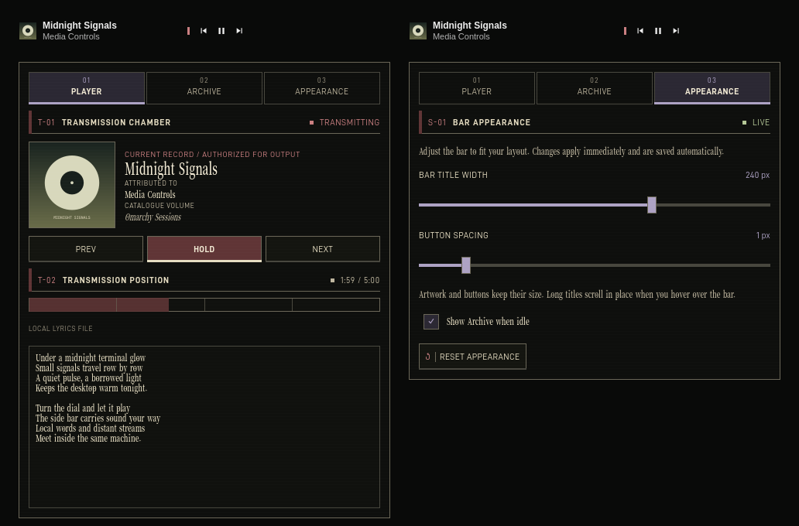

# Media Controls for Omarchy

MPRIS playback controls, artwork, lyrics, and a local music browser for Omarchy
Quattro. The plugin replaces the built-in media widget and supplies its own
player service.



The widget works on all four bar edges. Its title area and buttons keep a fixed
size as songs change. The bar and open player share the same track presentation:
text and artwork fade in over 140 ms, following the shell's animation setting.
Brief metadata gaps retain the previous track for up to 250 ms.
Track and playback updates settle for 80 ms before appearing, so intermediate
states from the player do not flash between songs.

## Install

```bash
omarchy plugin add https://github.com/ssupt/omarchy-media-controls.git --enable
```

The plugin ID is `ssupt.media-controls`. Enabling it replaces `omarchy.media`;
removing it while enabled restores the built-in widget.

| Dependency | Used for |
| --- | --- |
| Omarchy Quattro with its Quickshell shell | Plugin hosting and UI |
| Python 3.10 or later | Music, artwork, and lyrics helpers |
| An MPRIS player | Playback controls and metadata |
| `mpv` (optional) | Playing files and folders from the archive |
| `xdg-open` (optional) | Opening selections with the desktop's default application |
| `ffmpeg` and `ffprobe` (optional) | Embedded artwork and lyrics |
| Network access (optional) | LRCLIB lyrics lookup |

Each player determines whether previous, next, play/pause, and seeking are
available. The mpv backend needs an MPRIS plugin to expose bar controls.

## Use and resize

Click the bar's artwork or title to open the player. Scroll over the track label
for previous or next. When idle, **ARCHIVE** opens the local music browser.

The popup has three tabs:

- **Player:** artwork, track details, transport controls, seeking, and lyrics.
- **Archive:** browse and play local files or folders.
- **Appearance:** one size slider automatically controls title width on top and
  bottom bars or title length on side bars. Each orientation remembers its size.
  A separate, smaller slider adjusts playback button spacing. You can also
  choose whether Archive stays visible when idle.

**Right-click the bar's artwork or title to open Appearance directly.** Changes
apply immediately and save automatically. Artwork and buttons keep their size;
the size slider controls the reserved title area. Hover over the bar to scroll
long titles and artist names in place. Scrolling pauses at each end, resets when
you leave or change tracks, and follows the shell's animation setting.
**Reset appearance** restores the defaults.

| Setting | Default | Range |
| --- | --- | --- |
| Horizontal title width (`labelWidth`) | 180 px | 80–320 px |
| Side-bar title length (`verticalLabelLength`) | 125 px | 72–240 px |
| Playback button spacing (`buttonSpacing`) | 1 px | 0–8 px |
| Show Archive when idle (`showWhenIdle`) | Enabled | Enabled / disabled |

Dimensions are logical pixels before shell scaling. Values are stored in the
plugin's existing bar layout entry in `~/.config/omarchy/shell.json`.

In Archive, click a row to select it. Double-click a folder to enter it or a file
to play it. A row's **Play** button plays the file or folder recursively; the
toolbar's **Folder** button plays the current folder recursively.

| View | Key | Action |
| --- | --- | --- |
| Archive | Up / Down | Select an entry |
| Archive | Home / End | Select the first / last entry |
| Archive | Enter | Enter a folder or play a file |
| Archive | Ctrl+Enter | Play the selection, including a folder recursively |
| Archive | Backspace | Go to the parent folder |
| Archive | Escape | Go up; at the root, return to Player or close when idle |
| Archive | T | Open Player |
| Player | Space | Play / pause |
| Player | N / P | Next / previous track |
| Player | B | Open Archive |
| Player / Appearance | Escape | Close the popup |

Click the progress track to seek when supported. Lyrics are selectable,
scrollable text; timestamped lyrics appear as a plain transcript.

## Local music

The archive uses the first configured location in this order:

1. `MEDIA_CONTROLS_MUSIC_DIR`.
2. The result of `xdg-user-dir MUSIC`.
3. `$HOME/Music`, when neither supplies a location.

The chosen folder must exist and be readable. An invalid configured location is
reported in Archive. Contents update as files change, with folders first and
names sorted naturally.

Supported extensions, regardless of case:

```text
.flac .mp3 .ogg .oga .opus .m4a .mp4 .aac .alac .wav .wave
```

Selecting a file queues supported sibling files and starts at that track.
Selecting a folder queues supported files recursively. Playlists skip hidden
entries and directory symlinks. File symlinks must resolve inside the music
root, and selections outside that root are rejected.

Playback uses one reusable mpv session without a video window. New selections
replace its playlist and resume playback. If mpv is unavailable or fails, the
launcher tries `xdg-open`. For files, this opens the default application; for
folders, it opens the file manager without starting recursive playback. Archive
reports the backend and any launch error.

The service pauses the current player when possible before launching a
selection. It attempts to resume that player if launching fails or a folder
opens in the file manager. Transport controls always use MPRIS.

## Lyrics and artwork

Lyrics are requested when Player opens or its track changes. The first
available source is used:

1. The player's MPRIS `xesam:asText` metadata.
2. A same-name `.lrc` or `.txt` file beside a local audio file.
3. Embedded lyric tags read with `ffprobe`.
4. [LRCLIB](https://lrclib.net/docs), using track metadata.

Online lookup sends the title, artist, album, and duration when available. It
needs a title and artist, with no account or API key. Set
`MEDIA_CONTROLS_ONLINE_LYRICS=0` in the shell's startup environment to disable it;
local sources remain available.

Online results are cached in `$XDG_CACHE_HOME/omarchy/media-controls/lyrics`
(`~/.cache/omarchy/media-controls/lyrics` by default). Successful results are
reused; missing results expire after six hours. Service errors are not cached.
**Retry** bypasses the online cache while checking local sources first.

Artwork uses the player's MPRIS URL first. For local tracks without exported
artwork, the helper looks beside the track for `cover`, `folder`, or `front`
images, accepting JPG, JPEG, PNG, and WebP names without regard to case. It then
tries embedded artwork with `ffmpeg`. Extracted covers are cached under
`omarchy/media-controls/covers` in the cache directory and refreshed when the
audio file's size or modification time changes.

## Environment

Set these variables in the Omarchy shell's startup environment, then restart the
shell. Exporting a variable in a terminal does not affect an already running
shell.

| Variable | Default | Effect |
| --- | --- | --- |
| `MEDIA_CONTROLS_MUSIC_DIR` | XDG Music folder or `$HOME/Music` | Override the archive root. |
| `MEDIA_CONTROLS_ONLINE_LYRICS` | `1` | Set to `0`, `false`, `off`, or `no` to disable online lyrics. |
| `XDG_CACHE_HOME` | `~/.cache` | Base directory for artwork and lyrics caches. |
| `XDG_RUNTIME_DIR` | A private per-user directory under the system temporary directory | Base directory for mpv's socket, lock, and playlists. |

For custom installations and testing, executable paths can be supplied through
`MEDIA_CONTROLS_MPV`, `MEDIA_CONTROLS_XDG_OPEN`, `MEDIA_CONTROLS_XDG_USER_DIR`,
`MEDIA_CONTROLS_FFMPEG`, and `MEDIA_CONTROLS_FFPROBE`.
`MEDIA_CONTROLS_LRCLIB_BASE_URL` overrides the lyrics API endpoint.

## Troubleshooting

- **Archive unavailable:** Check the Music folder and its permissions. After
  creating a missing root or changing its environment setting, restart the shell.
- **Music plays but controls are absent:** Check that the player exposes MPRIS.
  The mpv backend needs an MPRIS plugin.
- **A folder opens in the file manager:** mpv was unavailable or failed. Install
  mpv to play folders recursively.
- **Lyrics are missing:** Check track metadata, local lyric files, and network
  access. Embedded lyrics need `ffprobe`. Use Retry to refresh a cached miss.

The service exposes Omarchy's `media` IPC target:

```bash
omarchy-shell media status
omarchy-shell media playPause
omarchy-shell media next
omarchy-shell media previous
```

`status` returns JSON; transport calls return `ok` or `unhandled`. `play`,
`pause`, and `ping` are also available.

## Update or remove

```bash
omarchy plugin update ssupt.media-controls
omarchy plugin remove ssupt.media-controls
```

## Development

The root `BarWidget.qml` and `Service.qml` are manifest entry points. The QML
implementation lives under:

| Path | Contents |
| --- | --- |
| `qml/bar/` | Bar widget and appearance persistence |
| `qml/player/` | Popup, player, archive, and appearance pages |
| `qml/components/` | Shared track presentation and artwork |
| `qml/services/` | MPRIS service and helper orchestration |
| `qml/style/` | Monumental theme and controls |
| `qml/Model.js` | Shared metadata and player logic |

Run checks from the repository root:

```bash
./test/all
omarchy plugin validate .
```

The suite needs Bash, Python, Node.js, jq, ripgrep, FFmpeg, Qt 6's `qmllint` and
`qmltestrunner`, Quickshell QML modules, and Omarchy shell imports. It checks
archive startup and navigation, fixed bar geometry, shared transitions,
appearance controls and save requests, playback handoff, extraction, lyrics
caching, path validation, playlist ordering, and launcher fallbacks. Tests use
temporary player stand-ins and make no online lyrics requests.

Set `OMARCHY_PATH` if Omarchy is installed outside `/usr/share/omarchy`:

```bash
OMARCHY_PATH=/path/to/omarchy ./test/all
```

Regenerate `preview.png` from the production QML with sample metadata:

```bash
python3 test/render-preview.py
```

The renderer also needs Qt 6's `qml` executable. CI runs the suite and manifest
validator in Arch Linux against the Omarchy revision pinned in
[the workflow](.github/workflows/ci.yml).

## License

Plugin code uses the [MIT license](LICENSE). Bundled DINish and Hakkou Mincho
fonts use the [SIL Open Font License 1.1](assets/fonts/OFL.txt).

More plugins: [omarchy-plugins](https://github.com/ssupt/omarchy-plugins).
